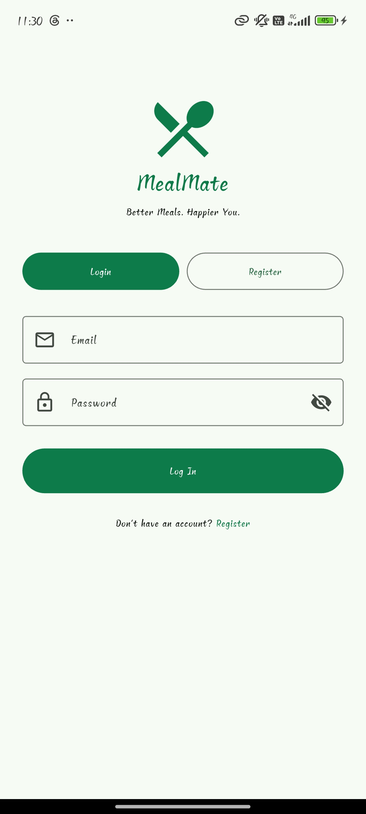
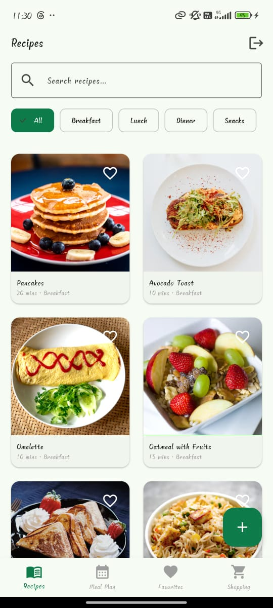
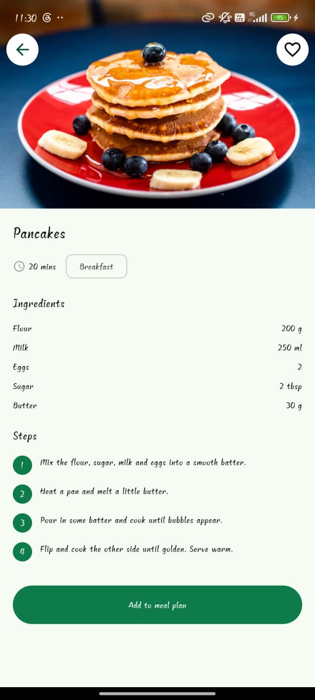
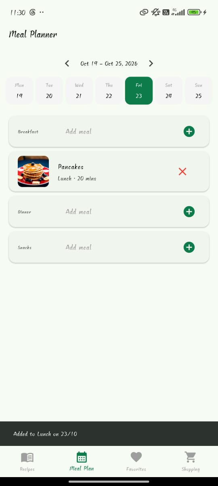
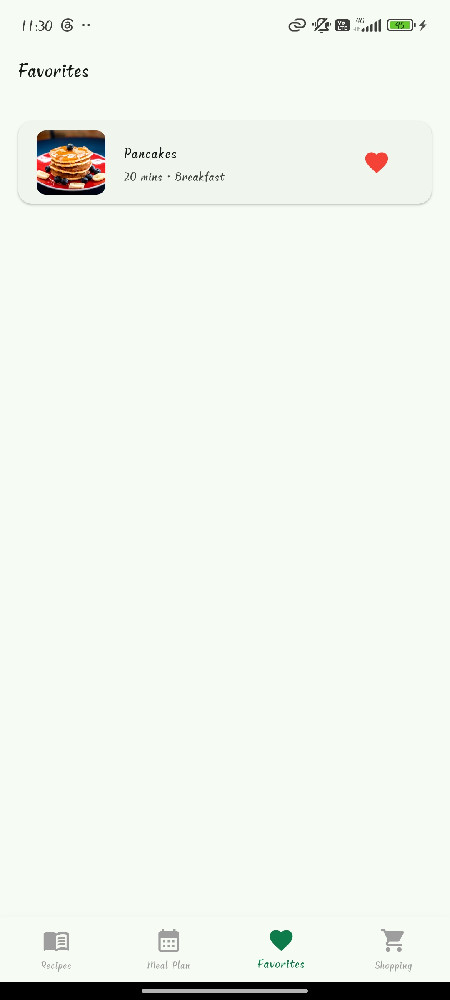
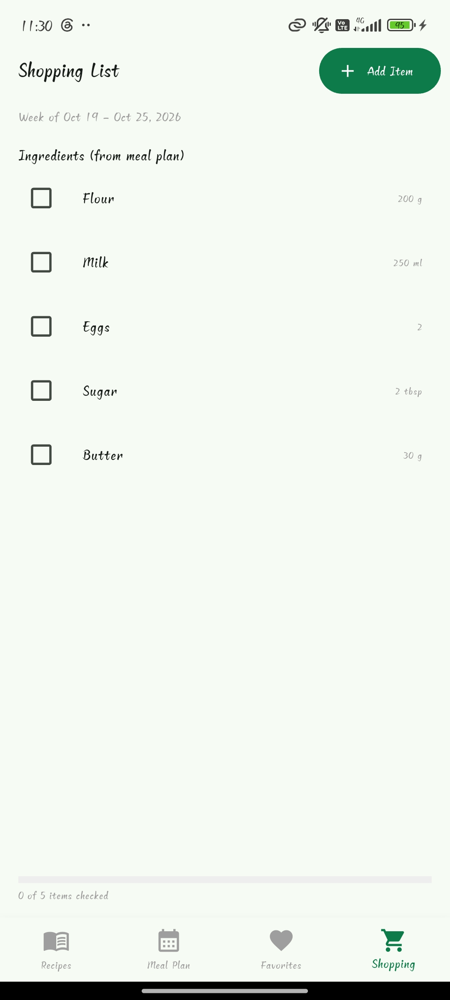

# MealMate – Recipe & Meal Planner

**Better Meals. Happier You.**

MealMate is a mobile app built with **Flutter** that helps users browse recipes, plan their meals for the week and build a shopping list automatically. The repository also contains a **Spring Boot + PostgreSQL** REST API for recipes.

## Screenshots

<table>
  <tr>
    <th align="center">Login</th>
    <th align="center">Recipes</th>
    <th align="center">Recipe details</th>
  </tr>
  <tr>
    <td align="center"></td>
    <td align="center"></td>
    <td align="center"></td>
  </tr>
  <tr>
    <th align="center">Meal plan</th>
    <th align="center">Favorites</th>
    <th align="center">Shopping list</th>
  </tr>
  <tr>
    <td align="center"><td>
    <td align="center"><td>
    <td align="center"></td>
  </tr>
</table>

## Features

- Splash screen, register and login with password rules (at least 5 characters, a lowercase letter and a number)
- Passwords are stored as SHA-256 hashes, and the session is remembered between launches
- 19 built-in recipes with photos (Breakfast, Lunch, Dinner, Snacks)
- Search and category filter
- Recipe details with ingredients and numbered steps
- Add your own recipes (and delete them again)
- Favorites with a heart icon
- Weekly meal planner with Breakfast, Lunch, Dinner and Snacks slots
- Shopping list built from the week's meal plan, with matching ingredients added together, manual items and a progress bar
- Custom app icon and name

## Tech stack

| Part | Technology |
|---|---|
| Mobile app | Flutter, Dart |
| Local storage | shared_preferences, crypto |
| Backend | Java 21, Spring Boot, Spring Data JPA |
| Database | PostgreSQL |
| Tools | Git, GitHub, VS Code |

## Project structure

```
recipe_planner/
  lib/
    data/        recipes, meal plan and shopping data
    models/      Recipe and Ingredient
    screens/     all app screens
    services/    auth and API services
    widgets/     reusable widgets
  assets/
    images/      recipe photos
    icon/        app icon
  recipe-backend/   Spring Boot REST API
  test/             unit test
```

## Run the Flutter app

1. Install Flutter and the Android SDK.
2. Connect an Android phone with USB debugging on (or start an emulator).
3. In the project folder:

```
flutter pub get
flutter run
```

For a standalone build that works without the cable:

```
flutter run --release
```

To create an installable APK:

```
flutter build apk --release
```

The file is created at `build/app/outputs/flutter-apk/app-release.apk`.

## Run the backend

1. Install JDK 21 and PostgreSQL, then create a database named `recipe_db`.
2. In `recipe-backend`, create a file named `local.properties` (it is ignored by Git) with your own database password:

```
spring.datasource.password=your_password
```

3. Start the server:

```
cd recipe-backend
./mvnw spring-boot:run
```

The API runs at `http://localhost:8080`.

| Method | Endpoint | Purpose |
|---|---|---|
| GET | `/recipes` | List all recipes |
| GET | `/recipes/{id}` | Get one recipe |
| POST | `/recipes` | Add a recipe |
| PUT | `/recipes/{id}` | Update a recipe |
| DELETE | `/recipes/{id}` | Delete a recipe |

## Tests

```
flutter test
```

## Current limitations and next steps

- The app currently uses its built-in recipes. Recipes you add, favorites and the meal plan are kept in memory and reset when the app is fully closed.
- Login is stored on the phone. The backend is ready to be extended with server-side users and JWT login.
- Google sign-in is not implemented.

Planned: save favorites and the meal plan on the device, connect the app to the Spring Boot API, JWT authentication, and Google sign-in.